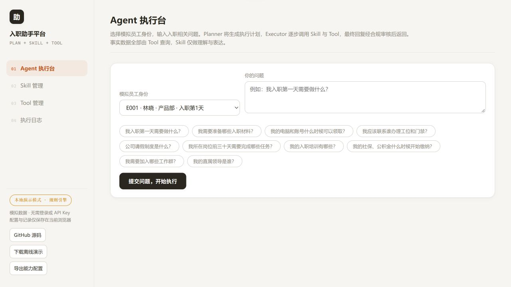
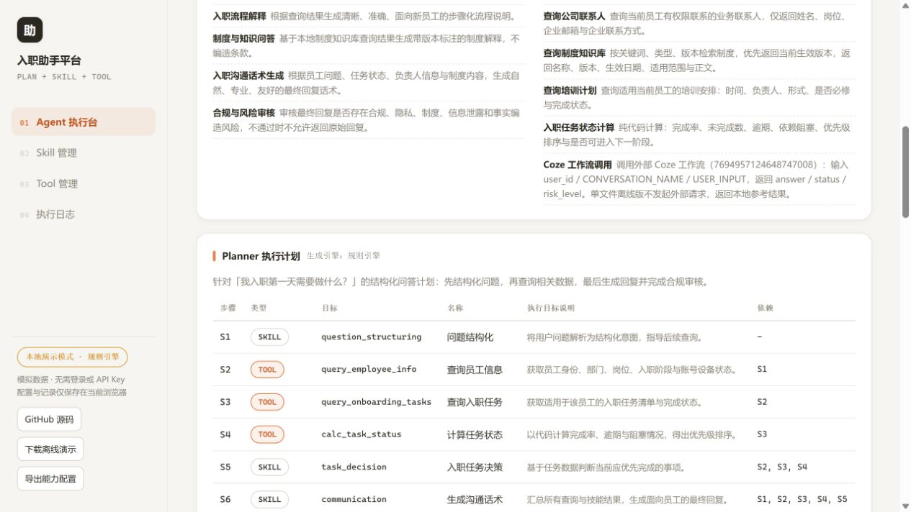
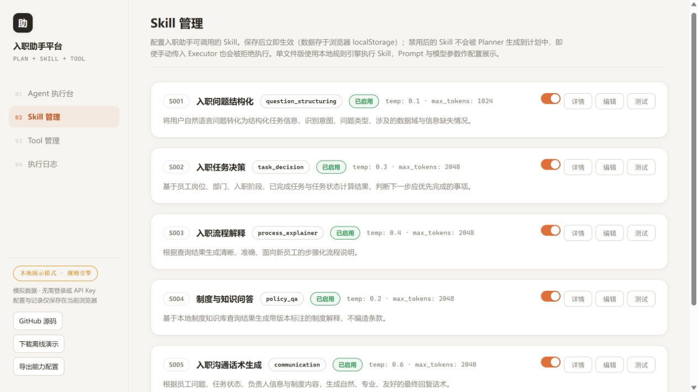
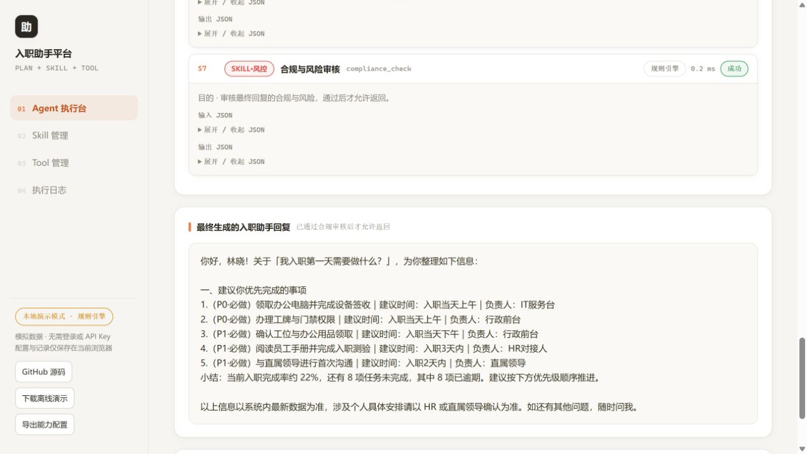
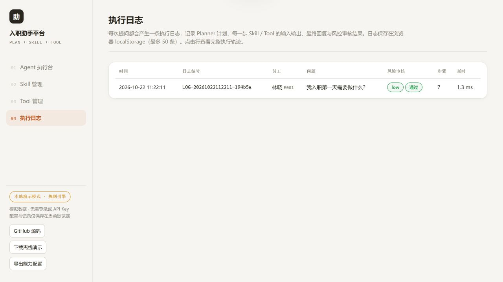
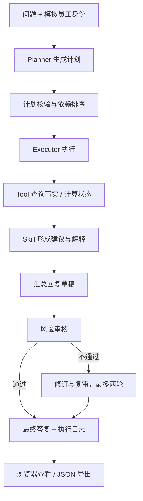

# 企业入职助手｜Agent 工作流产品原型

面向新员工的入职咨询与任务指引原型：结合员工的部门、岗位和入职阶段，查询待办、制度、培训和联系人，组织办理建议，并展示执行计划、输入输出和风险审核。

**[打开在线演示](https://2nott.github.io/onboarding-agent/) · [下载离线演示](https://github.com/2NOTT/onboarding-agent/releases/latest/download/onboarding-demo.html) · [下载完整项目 ZIP](https://github.com/2NOTT/onboarding-agent/archive/refs/heads/main.zip) · [完整使用与导出流程](docs/WORKFLOW.md)**

> 在线页面是纯静态、本地规则演示，使用模拟数据，不需要登录、API Key、后端服务或作者电脑。Coze 与大模型效果不是在线演示的验证范围。

## 三分钟体验

1. 打开在线演示，选择 `E001`，点击“我入职第一天需要做什么？”，提交执行。
2. 查看员工上下文、Planner 计划、Tool 查询与计算、Skill 输出、最终回复和审核结论。
3. 点击“导出本次流程 JSON”，保存包含计划、依赖、逐步输入输出、最终回复和审核结果的记录。
4. 进入“Skill 管理”，查看 Prompt、参数与单个 Skill 测试；进入“Tool 管理”查看能力和启用状态。
5. 在“执行日志”重看过程；用“导出能力配置”保存配置，或下载单文件在本机离线打开。

## 网站截图

以下图片来自实际浏览器操作，页面中的员工、制度和联系信息均为演示数据。

### 输入问题与选择员工



### 执行计划与逐步追踪



### 配置与单个技能检查



### 最终答复与办理建议



### 历史记录与流程导出



## 产品方案

| 业务问题 | 原型中的处理 |
| --- | --- |
| 新员工不知道先做什么 | 按部门、岗位和已达到阶段筛选任务，用代码计算进度、逾期、依赖和优先事项 |
| 制度和办理信息分散 | 将制度、培训、联系人和流程说明串成一次问答 |
| 回答依据与错误位置不清楚 | 展示能力快照、执行计划、每步输入输出、状态、耗时和审核结果 |
| 规则与提示词难以检查 | 提供 Skill 配置、启停、单独测试与执行日志 |
| 演示依赖复杂环境 | 提供不联网的单文件静态版，同时保留 Python 后端与前端源码 |

## 从问题到回复



“Skill”是本项目的可配置能力；“Tool”是代码定义的查询、计算或外部服务适配。后端通过自定义 JSON 计划分发调用，未使用模型 API 的原生 `tool_calls` 协议。

| 能力 | 范围 |
| --- | --- |
| 6 类 Skill | 问题结构化、任务建议、流程解释、制度问答、沟通话术、风险审核 |
| 7 项 Tool | 员工、任务、联系人、制度、培训查询，任务状态计算，Coze 工作流适配 |
| 模拟数据 | 10 名员工、36 条任务、16 条联系人、12 条制度、10 条培训 |
| 技术 | Python / FastAPI / httpx；HTML / CSS / JavaScript；本地 JSON |

## 下载与复现

### 方式一：离线演示，无需安装

下载 Release 中的 `onboarding-demo.html`，双击用浏览器打开。页面内嵌数据和规则，配置与最近 50 条执行记录保存在当前浏览器的 localStorage；不会同步到 GitHub 或作者电脑。

### 方式二：完整源码

```powershell
git clone https://github.com/2NOTT/onboarding-agent.git
cd onboarding-agent
python -m venv .venv
.\.venv\Scripts\python.exe -m pip install -r requirements.txt
.\.venv\Scripts\python.exe -m backend.main
```

访问 `http://localhost:8000/`，接口文档为 `http://localhost:8000/docs`。无需创建 `.env` 即可使用默认 Mock 路径。如需自行接入模型，复制 `.env.example` 为 `.env`，在本机填写自己的凭据并重启。

`FORCE_MOCK` 控制 LLM 路径，Coze 是否联网由 `COZE_API_TOKEN` 决定；离线演示请保持 Coze Token 为空。真实密钥只能放在本地后端环境中，不能写进静态 HTML、配置导出或 Git。

macOS / Linux 可使用 `source .venv/bin/activate` 后运行相同 Python 模块。

## 可导出什么

| 导出物 | 内容 | 复用方式 |
| --- | --- | --- |
| 本次流程 JSON | 问题、模拟员工、计划、依赖、每步输入输出、答复、风险和异常 | 在任意 JSON 查看器中审阅；按仓库源码复现调用链 |
| 能力配置 JSON | 当前 Skill Prompt / 参数 / 状态与 Tool 元数据 | 参考 `skills`、`tools` 两个字段，调整自己的本地配置 |
| 单文件 HTML | 完整静态界面、模拟数据和规则 | 下载后离线运行 |
| 仓库 ZIP | 前后端源码、演示版、检查脚本、说明与截图 | 解压后按说明运行或继续开发 |

可先查看真实浏览器导出的 [完整流程样例](docs/examples/first-day-execution.json) 和 [默认能力配置](docs/examples/capabilities.json)。

这些 JSON 使用本项目格式，**不是 Coze 原生工作流导入文件**。当前仓库不包含远端 Coze 工作流的导出定义，不能声称可一键导入 Coze 还原其节点。

## 检查与边界

```powershell
python scripts/check_secrets.py --self-test
python scripts/check_secrets.py --history
python -m unittest discover -s tests -v
node tests/test_demo.cjs
node tests/test_frontend_errors.mjs
```

完整说明见 [使用流程](docs/WORKFLOW.md)、[源码与 API 说明](docs/DEVELOPER_GUIDE.md)、[验证记录](docs/VERIFICATION.md) 和 [安全说明](SECURITY.md)。

在线演示的 Prompt 与模型参数用于展示配置，实际输出来自本地规则。前后端版保留真实接口适配，但真实 LLM / Coze 效果、企业 SSO、统一授权、并发与生产部署未在本项目中完成验收。制度查询为关键词和字段筛选，并非向量 RAG；局部隐私规则不等于企业级安全体系。

本项目是可演示的学习与作品原型；当前没有可验证的真实用户量、业务准确率或降本收益。
